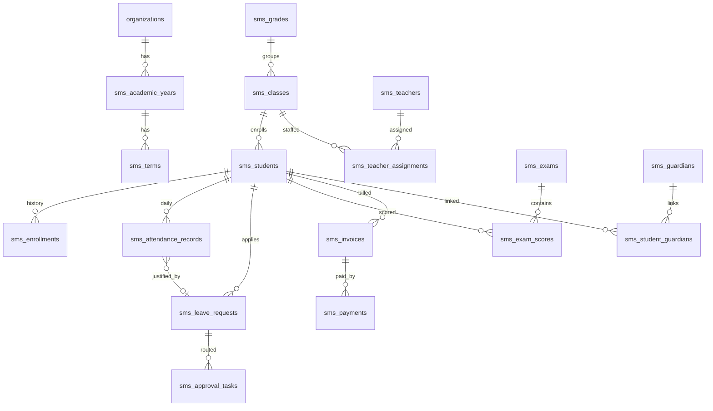

# 学校管理系统 Phase 0：领域模型、权限矩阵与能力清单

> 状态：**Draft（待评审）**。本阶段只产出设计、迁移草案与验收标准，不写业务代码、不改已有表结构。
>
> 基线：核心平台 + `modules/sms`（学籍/组织基础数据）+ Capability Chat（`docs/architecture/AGENT_ARCHITECTURE.md` §10–11）。

---

## 1. 目标与非目标

**目标**

1. 把「按角色的业务需求」固化成**可执行**的领域模型：表、关系、唯一约束、索引、软删除、审计。
2. 固化**权限命名规范**与**数据范围解析器**，让同一份定义同时服务 Apps、Chat、Agents。
3. 产出**能力清单（Capability）**：ID、operation、风险等级、审批方式、权限、表单、固定结果视图/聊天组件。
4. 给出**模块拆分**与**迁移规范**，并落第一份迁移草案（考勤 → 请假 → 预警）。
5. 定义每个切片的**验收清单**，后续每个 Phase 直接照此执行。

**非目标（本阶段）**

- 不新增数据库表、不写迁移文件、不改 `modules/sms` 业务代码。
- 不做 UI 视觉设计、不做报表引擎、不做排课算法实现。
- 不实现短信/微信/推送等外部通道（只留接口位）。

---

## 2. 现状基线

### 2.1 已有能力

| 层 | 已有 | 位置 |
|---|---|---|
| 组织/权限 | `tenants` / `organizations` / `departments` / `roles` / `users` / `organization_memberships` | `server/database/schema.ts` |
| 角色权限 | `roles.permissions: string[]`、`roles.data_scope: 'all' \| 'self'` | `server/database/schema.ts#L301-L319` |
| 审计 | `audit_logs`（actor/resource/action/before/after） | `server/core/audit.ts` |
| 学籍域 | 学年、学期、年级、学科、教师、班级、学生、任课分配、在读记录、监护人、学生-监护人关系 | `modules/sms/server/database/schema.ts` |
| 能力层 | `defineCapability`（`form`/`preview`/`resultView`/`summarize`/`riskLevel`/`permission`） | `server/core/capability.ts` |
| 执行层 | `ToolRegistry.run`（schema → 权限复检 → 限流 → 超时 → 输出上限） | `server/core/moduleSdk.ts` |
| 写入链路 | 草稿（30 分钟 TTL）→ 表单提交 → 执行；高风险走 `agent_approvals` | `server/utils/agentDraftService.ts`、`server/core/agentApproval.ts` |
| 聊天组件 | ` ```component ` 块 + 组件目录 API + 学生/教师表格 | `server/core/componentBlock.ts`、`server/core/componentCatalog.ts` |

### 2.2 关键缺口

1. **角色只有 `admin` / `user`**，没有「班主任 / 任课教师 / 家长 / 财务」等业务角色包（`server/database/seed.ts`）。
2. **数据范围只有 all/self**，无法表达「我带的班」「我孩子的记录」「我负责的年级」。
3. **班级没有班主任字段**：`sms_teacher_assignments` 只表达任课关系，无法做班主任范围判定。
4. **无教学业务表**：考勤、请假、作业、考试、成绩、课表全部缺失。
5. **无审批中心**：只有 Agent 审批（`agent_approvals`），没有业务请假/退费审批模型。
6. **无通知落点**：`notifications` 存在，但业务事件未定义。

---

## 3. 角色模型（权限包）

### 3.1 设计原则

- 角色名在 `roles` 表全局唯一，因此统一加命名空间：`sms.<role_code>`。
- **代码里不允许出现角色名判断**，只判断 permission；角色 → 权限包由种子/迁移写入。
- 一个用户可因 `organization_memberships.roleId` 在不同学校拥有不同角色。
- 角色只决定「能做什么」，数据范围由 §6 的 resolver 决定「能看到哪些行」。

### 3.2 角色与权限包

| 角色（role code） | 典型成员 | 权限包要点 |
|---|---|---|
| `sms.platform_admin` | 平台运维 | `*`（仅平台级；业务数据仍受组织隔离） |
| `sms.school_leader` | 校长/副校长/督导 | 全业务域 `.read` + 报表 + 审批（`sms.approvals.decide`），无财务写 |
| `sms.academic_director` | 教务主任 | 教学域读写、课表发布、成绩发布、审批 |
| `sms.academic_staff` | 教务员 | 学籍/排课/考务读写，成绩导入，不含发布 |
| `sms.grade_leader` | 年级组长 | 本年级范围内全教学域读写 + 审批（数据范围收窄） |
| `sms.subject_leader` | 教研组长 | 本学科作业/考试/成绩读写 |
| `sms.homeroom_teacher` | 班主任 | 本班学生、考勤、请假审批、评语；成绩只读 |
| `sms.teacher` | 任课教师 | 所授班级考勤/作业/成绩录入；学生基本信息只读 |
| `sms.student` | 学生 | 自己的课表/作业/成绩/请假申请 |
| `sms.guardian` | 家长 | 关联学生（多子女）的考勤/成绩/请假/缴费 |
| `sms.admissions` | 招生办 | 报名、录取、分班；学籍转入 |
| `sms.finance` | 财务 | 收费项、账单、收款、退费（退费需二次审批） |
| `sms.hr` | 人事/行政 | 教职工档案、合同、公文 |
| `sms.logistics` | 后勤 | 资产、报修、宿舍、食堂 |
| `sms.librarian` | 图书管理员 | 书目、借还 |
| `sms.counselor` | 心理/德育 | 德育记录、心理记录（独立高敏权限） |

**权限命名规范**：`sms.<resource>.<action>`，`action ∈ {read, create, update, delete, approve, publish, export}`。

- 兼容现有 `capabilityPermissionMatches`：`*`、`sms`、`sms:<action>`、`sms.<resource>`、`sms.<resource>.<action>`。
- 高敏域额外前缀：`sms.psychology.*`、`sms.finance.*`、`sms.scores.publish` 不随 `sms:update` 泛化。

> **落地说明（角色包）**：16 个角色由 `modules/sms/server/roles.ts` 的 `SMS_ROLE_PRESETS` 定义，`ensureSmsRoles()` 在每次启动时幂等执行：缺失角色创建，已存在角色只做权限并集（不覆盖管理员手工调整），`admin` 仍由核心种子重置为 `['*']`。
>
> 数据范围标志（`sms.attendance.all` / `sms.leave.all` / `sms.scores.all` / `sms.timetable.all`）只扩大可见行，**不授予发布或写入**；成绩/课表发布分别只认 `sms.scores.publish` / `sms.timetable.publish`。
>
> 角色 × 能力矩阵由 `modules/sms/test/roles.test.ts` 锁定：16 个角色 × 61 个能力逐对断言，并要求每个能力至少被一个非平台角色可达。

---

## 4. 业务域 → 模块归属

现有 `sms` 保持「组织 + 学籍」核心，其余按变更频率与团队边界拆分，避免单模块膨胀。

| 模块 ID | 覆盖业务域 | 说明 |
|---|---|---|
| `sms` | 组织基础数据、招生与学籍、监护人 | 已有，继续演进 |
| `sms-teaching` | 课表/教学计划、考勤、作业、考试与成绩 | 与教务强相关，读多写集中 |
| `sms-affairs` | 请假与审批、德育、社团、家校沟通、心理 | 依赖通知与审批引擎 |
| `sms-ops` | 财务、人事、资产后勤、宿舍食堂、图书 | 低频高权限，独立部署粒度 |
| `sms-analytics` | 报表与决策支持 | 只读，聚合查询，独立限流 |

**仓库与构建**

- 业务模块继续放在扩展仓库 `Nuxt-Extend-SMS`（`modules/*` 已被忽略，按模块加白名单）。
- 新增模块 = 1 个目录 + `modules.catalog.ts` 增加 import/entry + `nuxt.config.ts` 由 `ENABLED_MODULES` 自动挂载。
- 迁移表统一 `sms_` 前缀（同一 schema 命名空间），模块归属靠「表前缀组 + 迁移 id 前缀」区分，避免跨模块外键歧义。

> **落地说明（Slice A）**：`Nuxt-Extend-SMS` 目前是单层仓库（对应 `modules/sms`），因此首个切片先落在 `sms` 层内：业务代码在 `modules/sms/server/attendance.ts`，表为 `sms_attendance_*`，能力 id 仍按 `sms.attendance.*` 命名。等成绩、作业、课表三域稳定、需要独立发布节奏时，再按上面的边界拆成独立 Nuxt layer，能力 id 与权限字符串不需要变（避免破坏已有角色配置与聊天提示词）。

---

## 5. 领域模型

### 5.1 表清单

标记：`[新]` 新增、`[改]` 现有表加列、`[有]` 已存在。

#### 5.1.1 组织与基础数据（`sms`）

| 表 | 状态 | 关键字段 / 约束 |
|---|---|---|
| `sms_academic_years` | [有] | 已有 `is_current`；建议加唯一部分索引 `(organization_id) WHERE is_current` |
| `sms_terms` | [有] | `academic_year_id` + `name` 唯一 |
| `sms_grades` | [有] | `level` 用于排序/学段 |
| `sms_subjects` | [有] | `code` 组织内唯一 |
| `sms_classes` | [改] | 加 `homeroom_user_id`、`campus_id?`、`capacity` |
| `sms_teachers` | [有] | 与 `users` 1:1（组织内） |
| `sms_students` | [改] | 加 `gender`、`birthday`、`status`（在读/休学/转出/毕业）、`admission_year` |
| `sms_teacher_assignments` | [改] | 加 `role`（`homeroom` \| `subject` \| `assistant`），唯一索引改为 `(organization_id, teacher_user_id, class_id, subject_id, term_id)` |
| `sms_enrollments` | [有] | 在读记录，`status` 状态机 |
| `sms_guardians` / `sms_student_guardians` | [有] | 监护人手机号需脱敏展示 |

#### 5.1.2 招生与学籍（`sms`）

| 表 | 状态 | 关键字段 / 约束 |
|---|---|---|
| `sms_admission_cycles` | [新] | 招生季：学年、开放时间、计划人数 |
| `sms_applications` | [新] | 报名：`cycle_id`、姓名/证件/联系方式（加密或脱敏）、状态机 `draft→submitted→reviewing→offered→accepted→rejected→converted` |
| `sms_application_events` | [新] | 报名状态流转与操作人，审计补充 |
| `sms_student_status_events` | [新] | 休学/复学/转出/毕业，含生效日期与依据 |
| `sms_transfer_records` | [新] | 转入/转出：来源校、目标校、审批、学籍号 |

#### 5.1.3 排课与教学计划（`sms-teaching`）

| 表 | 状态 | 关键字段 / 约束 |
|---|---|---|
| `sms_rooms` | [新] | 教室/专用场地，容量、类型 |
| `sms_timetable_entries` | [新] | `term_id`、`class_id`、`subject_id`、`teacher_user_id`、`weekday`、`period_no`、`room_id`、`valid_from/valid_to`；唯一 `(organization_id, term_id, class_id, weekday, period_no)` 与教师冲突唯一 |
| `sms_timetable_versions` | [新] | 课表版本：`draft`/`published`，发布留痕 |
| `sms_lesson_plans` | [新] | 教案：学科、年级、周次、内容、附件、审核状态 |
| `sms_school_calendar` | [新] | 校历事件：类型（上课/放假/考试/活动）、起止日期 |

#### 5.1.4 考勤（`sms-teaching`）— **首个切片**

| 表 | 状态 | 关键字段 / 约束 |
|---|---|---|
| `sms_attendance_records` | [新] | `term_id`、`class_id`、`student_id`、`attendance_date`、`session`（`full_day`/`morning`/`afternoon`/`period`）、`period_no?`、`status`（`present`/`late`/`absent`/`excused`/`leave`）、`leave_request_id?`、`remark`、`recorded_by`、`updated_at` |
| `sms_attendance_alerts` | [新] | 规则（连续缺勤/月度缺勤率）、窗口、指标、阈值、状态（`open`/`acknowledged`/`resolved`） |
| `sms_attendance_rules` | [新] | 组织级规则配置：连续 N 天、月缺勤率阈值、是否自动通知 |

约束：

- 唯一：`(organization_id, student_id, attendance_date, session, COALESCE(period_no, 0))`。
- 索引：`(organization_id, class_id, attendance_date)`、`(organization_id, student_id, attendance_date)`。
- 状态机：`present ↔ late ↔ absent ↔ excused`，`leave` 只能由已审批请假写入或撤回时回落 `absent`。

#### 5.1.5 请假与审批（`sms-affairs`）

| 表 | 状态 | 关键字段 / 约束 |
|---|---|---|
| `sms_leave_requests` | [新] | 学生/教职工请假：`applicant_user_id`、`subject_type`（`student`/`staff`）、`type`（病假/事假/其他）、`start_at`、`end_at`、`reason`、`attachment_file_id`、`status`（`pending`/`approved`/`rejected`/`cancelled`）、`decided_by`、`decided_at` |
| `sms_approval_flows` | [新] | 流程模板：业务类型 → 审批层级（班主任 → 年级组长 → 学生处），按天数/金额分级 |
| `sms_approval_tasks` | [新] | 待办：`flow_id`、`subject_id`、`step`、`assignee_user_id`/`assignee_role`、`status`、`comment` |
| `sms_notifications`（复用核心） | [有] | 业务事件 → 站内通知；邮件/短信走适配器 |

说明：业务审批与 Agent 审批是两套模型（`agent_approvals` 管工具调用），不要混用；两者都写 `audit_logs`。

#### 5.1.6 作业与资源（`sms-teaching`）

| 表 | 状态 | 关键字段 |
|---|---|---|
| `sms_assignments` | [新] | 班级/学科、标题、说明、截止时间、发布状态 |
| `sms_assignment_submissions` | [新] | 学生提交、附件、批改状态、分数/评语 |
| `sms_resources` | [新] | 资源库：类型、学科、年级、文件 id、可见范围 |

#### 5.1.7 考试与成绩（`sms-teaching`）

| 表 | 状态 | 关键字段 |
|---|---|---|
| `sms_exams` | [新] | 考试：学期、类型（月考/期中/期末）、年级、科目、时间、满分 |
| `sms_exam_scores` | [新] | `exam_id`、`student_id`、`subject_id`、`score numeric(6,2)`、`grade_level`、`absent`、`entered_by` |
| `sms_score_reports` | [新] | 成绩单快照（发布后不可变）、PDF 文件 id、发布人 |
| `sms_grading_scales` | [新] | 等级制换算、权重、及格线 |

约束：`(organization_id, exam_id, student_id, subject_id)` 唯一；成绩修改留 `sms_score_revisions`（旧值/新值/原因/操作人）。

#### 5.1.8 学生事务与德育（`sms-affairs`）

| 表 | 状态 | 关键字段 |
|---|---|---|
| `sms_behavior_records` | [新] | 奖惩/违纪、级别、时间、处理人、附件 |
| `sms_awards` | [新] | 荣誉：名称、级别、获奖人/集体 |
| `sms_clubs` / `sms_club_members` | [新] | 社团与成员 |
| `sms_psychological_records` | [新] | 高敏：仅 `sms.psychology.*` 可读，默认脱敏、独立审计、不可导出 |

#### 5.1.9 家校沟通（`sms-affairs`）

| 表 | 状态 | 关键字段 |
|---|---|---|
| `sms_announcements` | [新] | 通知：范围（全校/年级/班级）、发布状态、已读统计 |
| `sms_feedback_tickets` | [新] | 家长反馈/咨询、处理状态 |
| `sms_consents` | [新] | 知情同意（外出活动、照片使用等）与签署记录 |

#### 5.1.10 财务（`sms-ops`）

| 表 | 状态 | 关键字段 |
|---|---|---|
| `sms_fee_items` | [新] | 收费项：名称、金额 `numeric(12,2)`、周期、适用年级 |
| `sms_invoices` | [新] | 应收账单：学生、收费项、金额、减免、状态（`unpaid`/`partial`/`paid`/`void`） |
| `sms_payments` | [新] | 收款：方式、流水号、时间、经办人 |
| `sms_refunds` | [新] | 退费申请与审批（二次审批）、原因 |
| `sms_finance_adjustments` | [新] | 减免/调整，需审批与审计 |

约定：金额一律 `numeric(12,2)`；不收付现金时必须有外部流水号；**禁止物理删除账单**，只允许 `void` + 原因。

#### 5.1.11 人事与行政（`sms-ops`）

| 表 | 状态 | 关键字段 |
|---|---|---|
| `sms_staff` | [新] | 教职工档案：岗位、入职、职称、状态（与 `users`/`sms_teachers` 关联） |
| `sms_staff_contracts` | [新] | 合同：起止、类型、附件 |
| `sms_staff_attendance` | [新] | 教职工出勤/请假（复用请假模型 `subject_type=staff`） |
| `sms_documents` | [新] | 公文/制度：类型、版本、可见范围 |

#### 5.1.12 资产与后勤（`sms-ops`）

| 表 | 状态 | 关键字段 |
|---|---|---|
| `sms_assets` | [新] | 资产：编号、类别、位置、状态（在用/闲置/维修/报废）、责任人 |
| `sms_asset_assignments` | [新] | 领用/归还记录 |
| `sms_maintenance_requests` | [新] | 报修：位置、描述、优先级、处理状态 |
| `sms_dorm_rooms` / `sms_dorm_assignments` | [新] | 宿舍与床位分配 |
| `sms_canteen_menus` | [新] | 每周菜单 |

#### 5.1.13 图书（`sms-ops`）

| 表 | 状态 | 关键字段 |
|---|---|---|
| `sms_books` | [新] | ISBN、书名、作者、馆藏数、可借数 |
| `sms_book_loans` | [新] | 借出/归还/逾期、借阅人 |

### 5.2 核心关系图



### 5.3 建模约束（所有新表）

1. `organization_id integer NOT NULL` + `tenant_id integer`（与现有表一致，回填自 `organizations`）。
2. 软删除 `deleted_at timestamptz`；**不物理删除**业务实体；状态机字段用 `status varchar(20)`。
3. 时间统一 `timestamptz`；业务日期用 `date`；金额 `numeric(12,2)`。
4. 业务唯一键按组织收敛：`<table>_org_<key>_idx`；查询索引按「组织 + 高频过滤列」。
5. 每条写能力必须写 `audit_logs`（`actorId`、`action`、`resource`、`resourceId`、`before/after` 摘要）。
6. 敏感字段（身份证、手机号、心理记录、成绩）在 API 层脱敏，聊天/导出默认不返回明文。
7. 历史不可变表（成绩单、审批、财务）不允许 `UPDATE` 覆盖语义，用修订/事件表。

---

## 6. 数据范围（Data Scope）

`roles.data_scope` 只保留 `all` / `self` 作为兜底；业务范围由模块 resolver 计算，**每个 capability 声明 `dataScope`**，查询必须经过 resolver。

| resolver | 含义 | 事实来源 | 适用 |
|---|---|---|---|
| `organization` | 全校 | `actor.organizationId` | 校长、教务、财务 |
| `self` | 本人 | `users.id` | 学生/教师本人数据 |
| `guardianLinked` | 关联学生 | `sms_student_guardians` | 家长 |
| `homeroomClass` | 班主任所在班 | `sms_classes.homeroom_user_id` 或 `sms_teacher_assignments.role='homeroom'` | 班主任 |
| `assignedClasses` | 所授班级 | `sms_teacher_assignments`（`role='subject'`） | 任课教师 |
| `gradeScope` | 所负责年级 | `sms_grade_managers`（新）或 `teacher_assignments` 推导 | 年级组长 |
| `subjectScope` | 所负责学科 | `sms_subject_leaders`（新） | 教研组长 |
| `departmentScope` | 部门 | `organization_memberships.department_id` | 人事/后勤/部门负责人 |
| `campusScope` | 校区 | `sms_campuses`（后续） | 分校区管理者 |
| `financeOwner` | 经办/负责账单 | `sms_payments.created_by` / `sms_invoices.owner_user_id` | 财务经办 |

规则：

- resolver 返回**结构化过滤条件**（`{ studentIds }` / `{ classIds }` / `{ sql }`），不返回整表后过滤。
- 详情/编辑接口必须同时校验 `organization_id` 与 resolver，跨范围返回 `404` 而非 `403`（避免枚举）。
- 每个 resolver 至少一条单测：命中、越界、无权限。

---

## 7. 权限矩阵（角色 × 业务域）

图例：`R` 只读、`W` 写（含创建/更新）、`A` 审批/发布、`—` 无。

| 角色 | 基础 | 招生学籍 | 排课 | 考勤 | 请假 | 作业 | 成绩 | 德育 | 家校 | 财务 | 人事 | 后勤 | 图书 | 报表 |
|---|---|---|---|---|---|---|---|---|---|---|---|---|---|---|
| platform_admin | W | W | W | W | W | W | W | W | W | W | W | W | W | R |
| school_leader | R | R | R | R | A | R | R | R | R | R | R | R | R | R |
| academic_director | R | W | W | W | A | W | A | R | R | — | — | — | — | R |
| academic_staff | R | W | W | W | R | R | W | — | R | — | — | — | — | R |
| grade_leader | R | R | R | W | A | W | W | R | R | — | — | — | — | R |
| subject_leader | R | R | R | R | — | W | W | — | — | — | — | — | — | R |
| homeroom_teacher | R | R | R | W | A | W | R | W | W | — | — | — | — | — |
| teacher | R | — | R | W | — | W | W | — | R | — | — | — | — | — |
| student | — | — | R | R | W(本人) | R | R | — | R | R(本人) | — | — | R | — |
| guardian | — | — | R | R(子女) | W/A(子女) | R(子女) | R(子女) | R(子女) | W | R(子女) | — | — | — | — |
| admissions | — | W | R | — | — | — | — | — | — | — | — | — | — | R |
| finance | — | R | — | — | — | — | — | — | — | W(+退费 A) | — | — | — | R |
| hr | — | — | — | R(教职工) | A(教职工) | — | — | — | — | — | W | — | — | R |
| logistics | — | — | R | — | — | — | — | — | — | — | — | W | — | — |
| librarian | — | R | — | — | — | — | — | — | — | — | — | — | W | — |
| counselor | R | — | — | R | R | — | — | W(+心理) | W | — | — | — | — | R |

> 「W」只是上限；实际能力按风险等级再叠加表单/审批（见 §8）。

---

## 8. Capability 清单

字段说明：`risk` = `low|medium|high`；`approval` = `none|confirm|second-person`；`perm` 为所需权限；`view` 为固定结果视图/聊天组件。

### 8.1 通用约定

- 读能力：`operation='query'`，直接执行，必须提供 `resultView`，列由服务端投影，模型不能生成列。
- 写能力：`operation='command'`，必须提供 `form` + `preview`；`medium` 走草稿确认，`high` 走审批。
- 所有写能力 `idempotencyKey` 必须覆盖业务唯一键（如学生+日期+场次）。
- 批量导入/导出单独能力，`risk='high'`，`approval='second-person'`。

### 8.2 首个切片：考勤 → 请假 → 预警（`sms-teaching` + `sms-affairs`）

> 实现进度：`sms.attendance.roster`、`records.list`、`summary`、`mark`、`alerts.list`、`alerts.ack` 已注册并通过单元测试；`batch-mark` 通过模块 API `POST /api/modules/sms/attendance/batch` 由 `sms.attendance-roster` 组件调用（不入聊天能力，避免模型伪造点名行）；预警阈值使用常量（`ATTENDANCE_RULES`），规则表留到配置 UI 落地。
>
> 请假（`sms:006-leave`）已落地：`sms_leave_requests` + `sms_approval_tasks`，能力 `sms.leave.apply/list/approve/reject/cancel` 与 `sms.approvals.list`；3 天及以上自动追加年级组长步骤（`resolveLeaveRoute`），审批通过写入 `leave` 考勤，撤销回退为 `absent`。聊天组件 `sms.leave-table`、`sms.attendance-roster` 已注册；组件 props 仅允许过滤条件，行数据始终由服务端 API 返回。
>
> Slice B（`sms:007-exams`）已落地：`sms_exams` / `sms_exam_scores` / `sms_score_revisions` / `sms_report_cards`；能力 `sms.exams.list/create`、`sms.scores.sheet/save/query/publish`、`sms.report-cards.generate`。成绩仅草稿考试可改，每次更正写不可变修订；发布为 high + `requiresApproval`；成绩单为不可变 JSON 快照。组件 `sms.grade-entry-sheet`。
>
> Slice C（`sms:008-admissions`、`sms:009-timetable`）已落地：招生批次/申请/事件表与 `sms_timetable_entries`；能力 `sms.admission-cycles.list/create`、`sms.applications.list/create/review/convert`、`sms.timetable.list/create/publish`。申请转换 high + `requiresApproval`（同一事务创建学生与选课）；课表提交前做班级/教师/教室冲突检测，发布为 high。组件 `sms.timetable-grid`。
>
> Slice D（`sms:010-finance`、`sms:011-assets-library`）已落地：`sms_fee_items/invoices/payments/refunds`（金额 `numeric(12,2)`）、`sms_assets/asset_events`、`sms_books/book_loans`；能力 `sms.fees.*`、`sms.invoices.*`、`sms.payments.create`、`sms.refunds.request/list/approve`、`sms.assets.*`、`sms.books.*`、`sms.loans.borrow/return`。退费为 high + `requiresApproval`，且申请人与审批人不能相同；资产与借还均写审计/事件。
>
> Phase 5 已落地：`sms.reports.attendance/scores/finance` 只读聚合（复用考勤/成绩/财务数据范围），`sms.reports.export` 导出 CSV 为 high + `requiresApproval`，单次最多 500 行，导出动作写审计。所有新增能力均已加入 `modules/sms/module.ts` 的 tools/permissions/database 清单，并由 `modules/sms/test/capabilities.test.ts` 锁定。
>
> Agent 自动化（`sms:012-report-runs`）已落地：`modules/sms/server/jobs.ts` 提供 `runAttendanceAlertScan()`（近 90 天全校 `full_day` 考勤分组，复用 `evaluateAttendanceAlerts`，按唯一索引去重写入 `sms_attendance_alerts`）与 `runWeeklyReport()`（按组织聚合上周出勤/请假/考试/财务，写 `sms_report_runs`，单组织失败记为 `failed` 不阻断其他组织）。Nitro 任务 `server/tasks/sms/attendance-scan.ts`、`server/tasks/sms/weekly-report.ts` 由 `nuxt.config.ts` 的 `scheduledTasks` 触发（每日 01:00 / 每周一 02:00）；serverless 部署需改为外部 Cron 调用任务路由。纯函数 `weekRange`/`previousWeekRange`/`buildWeeklySummary` 由 `modules/sms/test/jobs.test.ts` 覆盖。

| capability id | op | risk | approval | perm | view |
|---|---|---|---|---|---|
| `sms.attendance.roster` | query | low | none | `sms.attendance.read` | `sms.attendance-roster` |
| `sms.attendance.records.list` | query | low | none | `sms.attendance.read` | `resultView: table` |
| `sms.attendance.mark` | command | medium | confirm | `sms.attendance.update` | — |
| `sms.attendance.batch-mark` | command | medium | confirm | `sms.attendance.update` | — |
| `sms.attendance.correct` | command | medium | confirm | `sms.attendance.update` | — |
| `sms.attendance.summary` | query | low | none | `sms.attendance.read` | `resultView: table` |
| `sms.attendance.rules.list` | query | low | none | `sms.attendance.read` | `resultView: table` |
| `sms.attendance.rules.update` | command | medium | confirm | `sms.attendance.update` | — |
| `sms.attendance.alerts.list` | query | low | none | `sms.attendance.read` | `sms.alert-list` |
| `sms.attendance.alerts.ack` | command | low | confirm | `sms.attendance.update` | — |
| `sms.leave.apply` | command | low | confirm | `sms.leave.create` | — |
| `sms.leave.list` | query | low | none | `sms.leave.read` | `sms.leave-table` |
| `sms.leave.approve` | command | medium | confirm | `sms.leave.approve` | — |
| `sms.leave.reject` | command | medium | confirm | `sms.leave.approve` | — |
| `sms.leave.cancel` | command | low | confirm | `sms.leave.create` | — |
| `sms.approvals.list` | query | low | none | `sms.approvals.read` | `sms.approval-list` |

### 8.3 其余业务域（清单级）

| 域 | capability（读 / 写） |
|---|---|
| 组织基础 | `sms.classes.list` / `sms.classes.create`、`sms.classes.update`、`sms.classes.roster`（`sms.class-roster`）；`sms.terms.list` / `create`；`sms.subjects.list` / `create` |
| 招生学籍 | `sms.applications.list` / `sms.applications.create`、`submit`、`review`、`convert`(high)、`sms.enrollments.*`(已有)、`sms.students.transfer`(high)、`sms.student-status.change`(medium) |
| 排课 | `sms.timetable.list`（`sms.timetable-grid`）/ `sms.timetable.generate`(high)、`sms.timetable.publish`(high, second-person)、`sms.rooms.list` / `create`、`sms.lesson-plans.*` |
| 作业 | `sms.assignments.list` / `create`、`update`、`publish`；`sms.submissions.list` / `sms.submissions.grade` |
| 成绩 | `sms.exams.list` / `create`；`sms.scores.sheet`（`sms.grade-entry-sheet`）/ `sms.scores.save`(medium)、`sms.scores.import`(high)、`sms.scores.publish`(high, second-person)、`sms.scores.query`；`sms.report-cards.generate`（`sms.report-card`） |
| 德育 | `sms.behavior.list` / `create`；`sms.awards.list` / `create`；`sms.psychology.list` / `create`(high，独立权限) |
| 家校 | `sms.announcements.list` / `create`、`publish`；`sms.messages.send`；`sms.feedback.*`；`sms.consents.*` |
| 财务 | `sms.fee-items.list` / `create`；`sms.invoices.list`（`sms.invoice-table`）/ `sms.payments.record`(high)、`sms.refunds.request`、`sms.refunds.approve`(high, second-person)、`sms.receivables.summary`、`sms.finance.export`(high) |
| 人事 | `sms.staff.list` / `create`、`update`；`sms.staff-contracts.*`；`sms.staff-attendance.*`；`sms.documents.*` |
| 后勤 | `sms.assets.list` / `create`、`assign`、`return`、`retire`；`sms.maintenance.*`；`sms.dorm.*`；`sms.canteen.*` |
| 图书 | `sms.books.list` / `create`；`sms.loans.list` / `sms.loans.borrow`、`return` |
| 报表 | `sms.reports.enrollment`、`attendance`、`scores`、`finance`、`sms.reports.export`(high) |

### 8.4 新增聊天组件（按固定 ID 注册）

| 组件 id | 用途 | props（服务端校验） | 交互 |
|---|---|---|---|
| `sms.attendance-roster` | 班级考勤点名 | `classId?`、`date?`、`session?` | 标记、批量标记（权限 `sms.attendance.update`） |
| `sms.alert-list` | 考勤预警列表 | `status?`、`limit` | 确认/忽略 |
| `sms.leave-table` | 请假列表 | `status?`、`query?`、`limit` | 查看详情、审批 |
| `sms.timetable-grid` | 班级/教师课表 | `classId?`、`teacherId?`、`termId?` | 点击查看课程详情 |
| `sms.grade-entry-sheet` | 成绩录入表 | `examId`、`classId?` | 批量录入（不传行数据，组件自己取） |
| `sms.report-card` | 成绩单 | `studentId`、`termId?` | 下载 PDF（高敏，审批） |
| `sms.invoice-table` | 学生账单 | `studentId?`、`status?` | 查看明细、发起收款 |
| `sms.approval-list` | 待办审批 | `type?`、`limit` | 同意/驳回（二次确认） |
| `sms.class-roster` | 班级花名册 | `classId?`、`query?` | 详情（可编辑） |

---

## 9. 模块化与迁移规范

1. **模块定义**：`ModuleDefinition` 中 `permissions` 必须列出该模块用到的全部权限字符串（供角色配置页展示）。
2. **能力注册**：`register.ts` 只做装配，业务逻辑在 `server/<domain>.ts`；能力 id 与 permission 一一对应可审计。
3. **迁移 id**：`<moduleId>:<seq>-<slug>`，如 `sms-teaching:001-attendance`；`checksum` 变更 = 新迁移，不改历史。
4. **幂等**：DDL 一律 `IF NOT EXISTS`；回填用 `UPDATE ... WHERE ... IS NULL`；禁止在迁移里删除列/删数据。
5. **回滚**：每个迁移在文档中给 `down` 语句（`db:rollback:module` 使用），先删索引再删表。
6. **顺序**：核心 drizzle 迁移先执行，模块迁移按 `migrations` 数组顺序；模块间禁止跨表外键（只存 id + 组织校验）。
7. **种子**：角色包与规则默认值走可重复执行的 seed（`ON CONFLICT DO NOTHING`）。

---

## 10. 首批迁移草案（Slice A）

```sql
-- sms-teaching:001-attendance
CREATE TABLE IF NOT EXISTS sms_attendance_records (
  id                serial PRIMARY KEY,
  organization_id   integer NOT NULL,
  tenant_id         integer,
  term_id           integer,
  class_id          integer NOT NULL,
  student_id        integer NOT NULL,
  attendance_date   date NOT NULL,
  session           varchar(20) NOT NULL DEFAULT 'full_day',
  period_no         integer,
  status            varchar(20) NOT NULL,
  leave_request_id  integer,
  remark            varchar(255),
  recorded_by       integer NOT NULL,
  recorded_at       timestamptz NOT NULL DEFAULT now(),
  updated_at        timestamptz NOT NULL DEFAULT now(),
  created_at        timestamptz NOT NULL DEFAULT now()
);
CREATE UNIQUE INDEX IF NOT EXISTS sms_attendance_unique_idx
  ON sms_attendance_records (organization_id, student_id, attendance_date, session, COALESCE(period_no, 0));
CREATE INDEX IF NOT EXISTS sms_attendance_class_date_idx
  ON sms_attendance_records (organization_id, class_id, attendance_date);
CREATE INDEX IF NOT EXISTS sms_attendance_student_date_idx
  ON sms_attendance_records (organization_id, student_id, attendance_date);

CREATE TABLE IF NOT EXISTS sms_attendance_rules (
  id                  serial PRIMARY KEY,
  organization_id     integer NOT NULL,
  consecutive_absent  integer NOT NULL DEFAULT 3,
  monthly_rate        numeric(5,2) NOT NULL DEFAULT 20.00,
  notify_guardian     boolean NOT NULL DEFAULT true,
  updated_by          integer,
  updated_at          timestamptz NOT NULL DEFAULT now(),
  created_at          timestamptz NOT NULL DEFAULT now()
);
CREATE UNIQUE INDEX IF NOT EXISTS sms_attendance_rules_org_idx
  ON sms_attendance_rules (organization_id);

CREATE TABLE IF NOT EXISTS sms_attendance_alerts (
  id                serial PRIMARY KEY,
  organization_id   integer NOT NULL,
  tenant_id         integer,
  student_id        integer NOT NULL,
  rule              varchar(40) NOT NULL,
  window_start      date NOT NULL,
  window_end        date NOT NULL,
  metric            numeric(6,2) NOT NULL,
  threshold         numeric(6,2) NOT NULL,
  status            varchar(20) NOT NULL DEFAULT 'open',
  acknowledged_by   integer,
  acknowledged_at   timestamptz,
  created_at        timestamptz NOT NULL DEFAULT now()
);
CREATE UNIQUE INDEX IF NOT EXISTS sms_attendance_alerts_unique_idx
  ON sms_attendance_alerts (organization_id, student_id, rule, window_start);
CREATE INDEX IF NOT EXISTS sms_attendance_alerts_status_idx
  ON sms_attendance_alerts (organization_id, status);

-- sms-affairs:001-leave
CREATE TABLE IF NOT EXISTS sms_leave_requests (
  id                  serial PRIMARY KEY,
  organization_id     integer NOT NULL,
  tenant_id           integer,
  subject_type        varchar(20) NOT NULL DEFAULT 'student',
  student_id          integer,
  staff_user_id       integer,
  applicant_user_id   integer NOT NULL,
  type                varchar(20) NOT NULL,
  start_at            timestamptz NOT NULL,
  end_at              timestamptz NOT NULL,
  reason              varchar(500),
  attachment_file_id  integer,
  status              varchar(20) NOT NULL DEFAULT 'pending',
  decided_by          integer,
  decided_at          timestamptz,
  decision_note       varchar(255),
  created_at          timestamptz NOT NULL DEFAULT now(),
  updated_at          timestamptz NOT NULL DEFAULT now()
);
CREATE INDEX IF NOT EXISTS sms_leave_student_idx
  ON sms_leave_requests (organization_id, student_id, start_at);
CREATE INDEX IF NOT EXISTS sms_leave_status_idx
  ON sms_leave_requests (organization_id, status, created_at);

CREATE TABLE IF NOT EXISTS sms_approval_tasks (
  id                serial PRIMARY KEY,
  organization_id   integer NOT NULL,
  tenant_id         integer,
  subject_type      varchar(40) NOT NULL,
  subject_id        integer NOT NULL,
  step              integer NOT NULL DEFAULT 1,
  assignee_user_id  integer,
  assignee_role     varchar(80),
  status            varchar(20) NOT NULL DEFAULT 'pending',
  comment           varchar(500),
  decided_by        integer,
  decided_at        timestamptz,
  created_at        timestamptz NOT NULL DEFAULT now()
);
CREATE INDEX IF NOT EXISTS sms_approval_tasks_assignee_idx
  ON sms_approval_tasks (organization_id, assignee_user_id, status);

-- 班主任范围
ALTER TABLE sms_classes ADD COLUMN IF NOT EXISTS homeroom_user_id integer;
ALTER TABLE sms_teacher_assignments ADD COLUMN IF NOT EXISTS role varchar(20) NOT NULL DEFAULT 'subject';
CREATE INDEX IF NOT EXISTS sms_classes_homeroom_idx ON sms_classes (organization_id, homeroom_user_id);
```

回滚（文档留存，不在本期执行）：

```sql
DROP INDEX IF EXISTS sms_approval_tasks_assignee_idx;
DROP TABLE IF EXISTS sms_approval_tasks;
DROP INDEX IF EXISTS sms_leave_status_idx, sms_leave_student_idx;
DROP TABLE IF EXISTS sms_leave_requests;
DROP INDEX IF EXISTS sms_attendance_alerts_status_idx, sms_attendance_alerts_unique_idx;
DROP TABLE IF EXISTS sms_attendance_alerts;
DROP TABLE IF EXISTS sms_attendance_rules;
DROP INDEX IF EXISTS sms_attendance_student_date_idx, sms_attendance_class_date_idx, sms_attendance_unique_idx;
DROP TABLE IF EXISTS sms_attendance_records;
```

---

## 11. 验收清单（每个切片复用）

**数据层**

- [ ] 迁移重跑两次无报错；新表含 `organization_id`/`tenant_id`/`created_at`。
- [ ] 唯一约束与索引存在，`EXPLAIN` 命中预期索引。
- [ ] 软删除生效；业务表无物理删除路径。

**权限与范围**

- [x] 16 个角色包由 `ensureSmsRoles()` 幂等落库；`roles.test.ts` 覆盖 16 × 61 能力矩阵与负向断言。
- [x] 每个 capability 的 `permission` 已加入模块 `permissions` 与角色包 seed（`roles.test.ts` 校验预设权限均在清单内）。
- [ ] 数据范围四类测试：命中、越界（404）、跨组织（404）、无权限（403）。
- [ ] 高敏字段（手机号/证件/心理/成绩）默认脱敏，导出需审批。

**能力与聊天**

- [ ] 读能力有 `resultView`（或默认 `resultView.component`）。
- [ ] 写能力有 `form` + `preview`，提交前二次校验，失败恢复草稿。
- [ ] 高风险能力走 `agent_approvals`，参数哈希绑定，过期/重放测试通过。
- [ ] 聊天组件 ID 已注册，props schema 拒绝业务行数据，目录 API 按权限返回。
- [ ] 指标：非法块/未知组件/版本不匹配计数可见。

**质量**

- [x] 角色 × 能力矩阵测试（`roles.test.ts`）与定时任务纯函数测试（`jobs.test.ts`）通过。
- [ ] 单元测试覆盖 service + capability + resolver；e2e 覆盖 API；Playwright 覆盖一条完整交互链路。
- [ ] `pnpm lint`、`pnpm typecheck`（带 `ENABLED_MODULES`）、`pnpm test`、`pnpm build` 全绿。
- [ ] 更新 `AGENT_ARCHITECTURE.md`、`SECURITY_AUDIT.md` 与模块 README。

---

## 12. 待确认决策（含推荐默认值）

| # | 决策 | 推荐默认 |
|---|---|---|
| D1 | 学段/学制 | 用 `sms_grades.level` + 组织配置，不在代码写死 6/3/3 |
| D2 | 是否多校区 | v1 不建校区表，用 `departments` 过渡；Slice D 再引入 `sms_campuses` |
| D3 | 考勤粒度 | 支持 `session` + `period_no`，默认 `full_day` |
| D4 | 请假审批层级 | v1 单级班主任；≥3 天自动升级年级组长（规则表可配） |
| D5 | 成绩体系 | 百分制 + 等级换算表，支持权重；不内置 GPA |
| D6 | 财务范围 | 先做应收/收款/退费，不做总账与凭证 |
| D7 | 通知渠道 | 站内 + 邮件；短信/微信留适配器接口 |
| D8 | 移动端 | 响应式 Web（现有 UI），暂不做原生 App |
| D9 | 模块拆分 | 接受 `sms` / `sms-teaching` / `sms-affairs` / `sms-ops` / `sms-analytics` |
| D10 | 首条切片 | **考勤 → 请假 → 预警**（复用现有班级/学籍，能最快闭环验证权限、审批、通知） |

---

## 13. 路线图

| 阶段 | 内容 | 出口标准 |
|---|---|---|
| Phase 0 | 本文档 + 迁移草案 + 角色包 seed 设计 | 评审通过，D1–D10 确认 |
| Slice A | 考勤 / 请假 / 预警（`sms-teaching` + `sms-affairs`） | §11 全绿 |
| Slice B | 成绩录入 / 发布 / 成绩单 | 成绩发布审批与快照不可变验证通过 |
| Slice C | 招生 → 分班 → 课表 | 报名转为学籍全链路可回溯 |
| Slice D | 财务 / 资产 / 图书 | 退费二次审批与对账报表可用 |
| Phase 5 | 报表中心 + Agent 自动化（定时预警、周报） | 报表能力只读，导出审批留痕；`sms_report_runs` 留痕，每日预警扫描 + 每周一自动周报 |

---

## 14. 风险与应对

| 风险 | 影响 | 应对 |
|---|---|---|
| 数据范围实现错误导致越权 | 严重 | resolver 单一入口 + 四类测试矩阵 + 详情统一 404 |
| 角色/权限包漂移 | 权限失效或过宽 | 权限字符串集中在模块 `permissions`，seed 可重复执行，CI 校验未声明权限 |
| 跨模块表耦合 | 迁移顺序脆弱 | 模块内自洽，跨模块只存 id，不建外键 |
| 高敏数据进入聊天上下文 | 合规风险 | 能力层脱敏 + 组件只回聚合 + 心理域独立权限 |
| 历史数据迁移 | 数据丢失 | 只增列/回填，禁止删列；上线前快照 |
| 能力数量膨胀 | 模型选择困难 | 按域分组提示词，工具集按权限过滤；单轮上限保持不变 |

---

## 15. 三阶段智能化落地（P0 / P1 / P2）

### P0 可靠底座

- **通知中心**：`sms_notifications`（按组织 + 收件人隔离，站内链接只接受 `/` 开头）。考勤预警、请假提交/审批、退费申请/审批在同一事务内写通知；`sms.notifications.list/send` 能力 + `GET/POST /api/modules/sms/notifications`。
- **通用审批引擎**：`server/approvals.ts` 统一 `insertApprovalSteps / loadPending / complete / cancel`，请假与退费共用 `sms_approval_tasks`；新增 `due_at / escalated_at`，48h SLA 超时后按 `homeroom → grade_leader → school_admin` 升级，`sms:approval-escalate` 每小时执行。
- **角色链路 e2e**：`test/browser/sms-roles.pw.ts` 覆盖教师、家长、财务三类账号的允许/拒绝路径（仅当未启用演示账号 seed 时跳过）。
- **跨组织测试**：`integration.test.ts` 增加通知隔离、跨组织请假/退费 404、无权限 403。

### P1 效率与知识

- **校规知识库**：`sms_knowledge_articles` + `sms.knowledge.search/create`，按 `all/staff/student/guardian` 过滤可见范围，学生/家长不会检索到教职工制度。
- **角色工作台**：`GET /api/modules/sms/workbench` 按权限与班级范围返回未读通知、待审批、考勤预警、待审批退费卡片；`/sms/mobile` 提供移动端工作台与快捷入口，并登记 `manifest.webmanifest`（PWA 基础）。
- **批量导入**：`sms.students.import` + `POST /api/modules/sms/students/import`，CSV 解析、逐行校验、`dryRun` 预检与导入报告；单次上限 500 行。
- **日报预聚合**：`sms_report_daily`（组织/日期/班级唯一）+ `sms.reports.daily` 查询；`sms:daily-report` 每天 03:00 生成昨日汇总。

### P2 智能化与教学域

- **任务型 Agent**：`sms_agent_tasks` + 显式状态机（`pending → running ⇄ waiting_approval → done/failed/cancelled`），`sms.agent-tasks.list/create/advance`，步骤与错误持久化，重启后可恢复。
- **评估体系**：`server/evaluation.ts` 维护中文 golden case 与 precision/recall 计算，`agentTasks.test.ts` 校验期望能力存在、写能力具备 preview。
- **教学域最小闭环**：`sms_assignments / sms_assignment_submissions / sms_course_elections`，能力覆盖布置作业、查询、学生提交、批改、选课查询与选课/退选；学生只能操作自己的记录，教师受所授/班主任班级限制。

**当前能力规模**：76 个能力（44 个写能力），16 个角色预设；`modules/sms/test` 20 个文件 / 115 个用例。

---

## 16. 16 项优化落地（一致性、可运维性与移动端）

迁移 `sms:019-optimization` 只做增量 DDL（`ADD COLUMN IF NOT EXISTS` / `CREATE TABLE IF NOT EXISTS`），不删列。

### P0 缺陷修复

- **动态聊天提示词**：`chatPrompt.ts` 改为从已注册能力按 actor 权限实时生成“可查/可写”清单，删除过期的“学生不能写”硬编码；学生提示包含提交作业、选课、请假。
- **作业班级校验**：`teaching.createAssignment` 在组织校验之后增加“所授/班主任班级”校验，非全校角色跨班布置返回 403。
- **工作台链接**：通知卡片指向 `/notifications`，审批/退费卡片指向新增 `/sms/approvals`，不再出现 404。
- **定时考勤扫描通知**：`runAttendanceAlertScan` 按学生聚合新增预警后写入站内通知，并记录 `sms_report_runs(kind=attendance_scan)`。
- **API 限流**：`ModuleApiDefinition.rateLimit` + `ModuleApiRouter` 固定窗口限流，路由返回 429；SMS 默认读 120/分、写 30/分，导入/发布/审批等敏感接口单独收紧。

### P1 效率与一致性

- **日报批量 upsert**：`runDailyReport` 按 200 行分块写入，单条 SQL 完成冲突更新；工作台考勤预警改为 `sms_attendance_alerts innerJoin sms_students` 直接按班级过滤。
- **知识库**：`sms.knowledge.update` 支持编辑与 `action=archive` 下架（保留引用），检索结果附带 `citation`；迁移创建 `pg_trgm` GIN 索引（无权限时自动跳过）。
- **导入**：学生导入改为单批 `onConflictDoNothing`（学号天然幂等），返回 `batchId / errorsCsv / imported / skipped`；新增 `sms.scores.import` 成绩 CSV 导入（仅草稿考试，复用 `saveScores`）。
- **统一审批收件箱**：`listApprovalInbox` 合并请假/退费待办、SLA 超时标记，`sms.approvals.list` 与 `GET /api/modules/sms/approvals` 共用；新增 `reassignApprovalTask` 转交（重置 SLA + 通知 + 审计）。
- **通知偏好**：`sms_notification_preferences` 按用户 × 分类静音，`createNotifications` 写入前过滤；`SMS_NOTIFICATION_WEBHOOK_URL` / `SMS_NOTIFICATION_EMAIL_MODE=log` 提供外发适配器。
- **教学域**：作业支持 `rubric`，提交支持 `attachmentUrl`（仅站内路径/http(s)）；`sms_subjects.capacity` 限制选课容量，满员返回 409。
- **移动端**：`/sms/mobile` 增加原生请假表单与未读通知已读操作；`manifest.webmanifest` 补齐图标，`sw.js` 仅由移动页注册，提供离线提示。

### P2 可观测性与测试

- **Agent 执行器**：`sms_agent_task_events` 事件流、`idempotency_key` 幂等创建、`failed → pending` 重试、取消写入 `cancelledAt`；新增 `sms.agent-tasks.events` 查询。
- **评估**：golden set 扩到 30 条；`sms_evaluation_metrics` 时序指标 + `sms.evaluation.metrics` 查询/写入接口。
- **审计与指标**：`sms.audit.query` 只读查询本组织 SMS 审计；`GET /api/modules/sms/metrics` 汇总通知、审批 SLA、导入批次、Agent 失败。
- **e2e 账号**：`SEED_SMS_DEMO_USERS=true` 时由 `modules/sms/server/demoUsers.ts` 幂等创建 `teacher/guardian/finance` 演示账号与组织成员关系；Playwright 不再无条件跳过。

**优化后规模**：81 个能力（46 个写能力），16 个角色预设；`modules/sms/test` 21 个文件 / 119 个用例。

### 运维开关

| 变量 | 作用 |
|---|---|
| `SEED_SMS_DEMO_USERS=true` | 创建 SMS e2e 演示账号（生产环境强制忽略） |
| `SMS_NOTIFICATION_WEBHOOK_URL` | 站内信落库后写入 outbox，由任务异步 POST 到企业微信/网关 |
| `SMS_NOTIFICATION_WEBHOOK_SECRET` | Webhook 请求体 HMAC-SHA256 签名密钥（`X-SMS-Signature`） |
| `SMS_NOTIFICATION_EMAIL_MODE=log` | 以日志方式打印邮件载荷（调试用） |
| `SMS_TIMEZONE` | 业务时区，默认 `Asia/Shanghai`，影响“今天/本周”与日报日期 |
| `SMS_KB_EMBEDDING_ENDPOINT` | 可选 embedding 服务；配置后知识库写入向量并做 JS 余弦重排 |
| `SMS_KB_EMBEDDING_TOKEN` | embedding 服务 Bearer Token（可选） |
| `RATE_LIMIT_DRIVER=postgres` | 模块 API 限流改为多实例共享计数 |
| `SMS_MODULE_REF`（CI 变量） | 固定 CI 克隆的 SMS layer 分支/提交 |

### 可靠性、分页与运维（第二轮）

- **共享限流**：`ModuleApiRouter` 不再自建内存桶，统一注入 `RateLimitStore`；默认内存，`RATE_LIMIT_DRIVER=postgres` 时多实例共享预算。
- **业务时区**：新增 `modules/sms/server/time.ts`（`SMS_TIMEZONE`，默认 Asia/Shanghai）；日报、考勤默认日期、周报/报表区间与 90 天回溯全部改为按时区取日历日，修复上海 00:00–08:00 跨日错位。
- **CSV 公式注入**：错误文件导出对 `= + - @`、制表符、回车开头的内容前置 `'`，避免 Excel 执行公式。
- **通知 outbox**：站内信与 `sms_notification_outbox` 同事务写入，`sms:notification-outbox` 每分钟投递；指数退避（1→60 分钟）、`attempts/max_attempts/last_error` 可审计，Webhook 支持 HMAC 签名。
- **附件归属**：作业提交支持 `attachmentFileId`，校验 `files.organization_id` 与未删除状态；`attachmentUrl` 保留兼容。
- **保留策略**：`sms:retention` 每日清理 90 天通知、180 天 Agent 事件、365 天评估指标/报表运行，以及 30 天已终结 outbox 行，并写审计。
- **游标分页**：学生、通知、审计、Agent 事件列表支持可选 `cursor`（`id < cursor`），返回结构保持数组。
- **管理页**：新增 `/sms/knowledge`（知识库发布/下架）、`/sms/notifications`（分类静音）、`/sms/scores/import`（干跑预览 + 错误 CSV 下载）；移动工作台增加审批收件箱入口与离线请假队列（恢复网络自动补交）。
- **Prometheus**：`GET /api/modules/sms/metrics/prometheus` 输出 exposition 文本（聚合计数，不含个人信息）。
- **后台任务队列**：`sms_background_jobs` + `sms:job-worker`；导入支持 `defer=true` 入队，HTTP 只返回 `jobId`；任务与 outbox 均通过 `FOR UPDATE SKIP LOCKED` + 短租约抢占，多副本不会重复领取。
- **语义检索（可选）**：配置 `SMS_KB_EMBEDDING_ENDPOINT` 时文章写入 `jsonb` 向量并做 JS 余弦重排；`sms:embedding-backfill` 每日为存量文章补向量；未配置时保留 pg_trgm/ILIKE 关键词检索。
- **监控**：Prometheus 端点新增 outbox / background job 积压指标；告警规则见 [SMS_MONITORING.md](../operations/SMS_MONITORING.md) 与 `ops/prometheus/sms-alerts.yml`。
- **CI**：新增 Playwright job（Postgres + `SEED_SMS_DEMO_USERS=true` + dev server）；SMS layer 通过 `SMS_MODULE_REF` 固定；coverage include 增加 `modules/sms/**`，先以 25% 行覆盖作为防倒退底线（目标 60%）。

**第二轮后规模**：`modules/sms/test` 24 个文件 / 135 个用例；全仓 804 个用例；迁移新增 `sms:020-reliability`。

### 已知限制

- 任务租约为 5 分钟：单个任务执行超过租约时，另一个副本可能重复领取；导入本身幂等，超长任务建议拆分。
- embedding 向量只存储在 `jsonb`，检索在应用侧排序；文章量很大时应迁移到 pgvector。
- 知识库管理页支持正文编辑/预览，但暂不支持图片上传与富文本。

## 角色与业务缺口（第三轮评估）

### 1. 角色覆盖盘点

已有 16 个角色预设（`modules/sms/server/roles.ts`），但多数只覆盖“读写权限”，未覆盖该角色的完整工作流。

| 角色 | 已覆盖 | 关键缺口 |
|---|---|---|
| 平台运维 | 组织、权限、审计 | 租户生命周期、SSO、数据导入导出、配额、集成管理 |
| 校长/督导 | 全校只读、审批、报表 | KPI 驾驶舱、教师评价、预算审批、合规上报 |
| 教务主任 | 教学域读写、发布 | 排课冲突、分班/走班、教材、毕业审核 |
| 教务员 | 学籍/考务 | 学籍异动、考试编排/监考、成绩复核 |
| 年级组长 | 本年级教学 | 年级横向对比、教师工作量、教学进度 |
| 教研组长 | 本学科考试 | 教研活动、题库、集体备课、听评课 |
| 班主任 | 本班学生/考勤/审批 | 家长通讯录、家访、德育积分、座位表、班级公告 |
| 任课教师 | 考勤/成绩录入 | 成绩册、作业批改、课堂表现、调代课 |
| 学生 | 课表/成绩/请假 | 选课、社团、作业提交、图书借阅、问卷 |
| 家长 | 子女考勤/成绩/缴费 | 多子女切换、在线支付、请假代提、回执签署、家长会预约 |
| 招生办 | 报名/录取 | 面试安排、候补、录取通知、转学学分 |
| 财务 | 收费/退费 | 分期、对账、发票、减免/奖学金、支付回调 |
| 人事 | 教职工档案 | 招聘、合同、资质到期、考勤/调代课、绩效 |
| 后勤 | 资产/报修 | 采购、领用、盘点、宿舍、校车、食堂 |
| 图书管理员 | 书目/借还 | 预约、逾期罚金、丢书赔偿、阅读活动 |
| 心理/德育 | 学生只读 | 心理测评、危机干预、家校沟通记录 |

### 2. 业务缺口优先级

**P0（影响日常运转）**

- 学籍异动：转入/转出/休学/复学/毕业审核。
- 选科/分班/走班，以及排课冲突检测。
- 考试编排：考场、监考、阅卷、补考、成绩复核。
- 家长在线缴费、支付回调与对账。
- 家长多子女切换、请假代提。
- 通知回执/签收：制度、成绩单、告家长书。

**P1**

- 德育积分/奖惩/申诉；心理测评与危机干预。
- 宿舍分配/查寝、校车路线/上下车、食堂订餐/过敏原。
- 物资采购/领用/盘点、报修工单 SLA。
- 教师考勤/调代课/工作量；招聘、合同、资质到期提醒。
- 图书馆预约、罚金、丢书赔偿。
- 招生面试、候补、录取通知。

**P2**

- 社团/活动/竞赛/志愿时长。
- 家长会预约、问卷、家校沟通记录。
- 会议室/场地预约、文件签收。
- 校友、毕业去向、教育局数据上报。
- 合规中心：隐私授权、数据保留、审计导出。

### 3. 权限与数据边界缺口

- 家长多子女缺少聚合 scope，需支持“当前孩子”切换与按孩子授权。
- “所授班级”与“班主任班级”需区分读写：任课教师不应批改非本班请假。
- 退款/减免缺少双人复核（second-person approval）。
- 校医/心理数据需要独立权限与字段脱敏。
- 教育局上报需要只读、去标识化导出角色。

### 4. 界面体验改进 backlog

| 优先级 | 改进 | 说明 |
|---|---|---|
| P0 | 角色化首页 | 教师/班主任/家长/财务/后勤进入后先看到“今天要做什么”，而不是统一聊天框 |
| P0 | 专业列表页 | 学生、班级、成绩、财务、资产目前主要靠 Chat/API，缺少可扫描、可批量的表格页 |
| P0 | 审批工作台 | 批量审批、SLA 倒计时、意见模板、详情抽屉、移动端手势与深链 |
| P1 | 全局搜索/命令面板 | 跨学生、班级、通知、知识库的 `⌘K` 搜索 |
| P1 | 列表能力 | 保存筛选、列配置、导出、空状态引导、骨架屏、虚拟滚动 |
| P1 | 表单能力 | 分步、草稿、自动保存、字段级错误、防重复提交 |
| P1 | 移动端 | 底部导航、离线队列可视化、拍照上传、扫码 |
| P2 | Chat 体验 | 引用来源、操作确认卡、结果可撤销、失败回退 |
| P2 | 权限可见性 | 无权限时解释原因并给申请入口，而不是空白或报错 |
| P2 | 可访问性 | 键盘导航、对比度、字号、屏幕阅读器、减少动画 |
| P2 | 性能 | 首屏拆分、缓存、乐观更新、统一日期时区展示 |

## P0 界面落地（第四轮）

本轮把第三轮评估中的 P0 界面与高频业务落地，仍不做学籍异动、选科排课、在线支付等大型领域。

### 已完成

- **角色工作台**：`/sms` 不再是聊天重定向，按角色展示待审批、超时审批、考勤预警、退费、未结清账单、待发布成绩、待审核报名等卡片；`server/workbench.ts` 统一计数，复用权限与数据范围。
- **专业列表页**：新增 `/sms/students`（搜索、班级筛选、游标分页、批量选择、CSV 导出）、`/sms/classes`（年级/学年展示）、`/sms/scores`（考试/班级/学生筛选、CSV 导出）。
- **审批工作台**：`/sms/approvals` 支持状态筛选（待办/已通过/已驳回/已取消/全部）、多选批量同意/驳回、审批意见、详情抽屉与 SLA 倒计时；新增 `POST /api/modules/sms/approvals/decide`，单条失败不影响其他条，事务/审计/通知仍由 leave、finance 领域服务负责。
- **导入向导**：成绩导入与学生导入改为「上传 → 字段映射/干跑预览 → 确认写入」三步，错误 CSV 可下载；学生导入可选 `defer` 后台执行。
- **通知中心**：`/sms/notifications` 为收件箱（未读/全部、分类筛选、全部已读、深链、加载更多）；偏好页独立为 `/sms/notifications/preferences`。
- **全局搜索**：`GET /api/modules/sms/search` 聚合学生、班级、知识库、通知；SMS 布局提供 ⌘K / Ctrl+K 命令面板。
- **移动端**：`/sms/mobile` 增加固定底部导航（工作台/审批/通知/我的），保留离线请假队列与 PWA。
- **API 清单**：新增 `GET /api/modules/sms/classes`、`GET /api/modules/sms/subjects`、`GET /api/modules/sms/search`、`POST /api/modules/sms/approvals/decide`；`module.ts` 导航与接口清单同步。

### 仍未做（按优先级）

- P0：学籍异动（转入/转出/休学/复学/毕业审核）、选科/分班/走班与排课冲突、考试编排/监考/补考、家长在线缴费与对账、家长多子女切换、通知回执/签收。
- P1：德育积分、心理测评、宿舍/校车/食堂、采购报修、教师考勤/调代课、图书馆预约罚金、招生面试候补。
- P2：社团活动、家长会预约、场地预约、校友与教育局上报、合规中心。

### 已知限制

- 成绩列表单次最多 200 条，暂未做服务端游标分页。
- 列表页导出为前端生成 CSV，超大数据量需改为服务端异步导出。
- 批量审批逐条串行执行，单次上限 50 条；跨类型混合审批时权限不足的条目会单独返回失败原因。

### 第五轮：学籍异动

- 学生新增 `status`（在读/休学/已转出/已毕业）与 `sms_student_movements` 异动流水表（迁移 `sms:021`）。
- 支持转入、转出、休学、复学、毕业五种异动，状态机校验在服务端完成；转出/毕业会结束在读学籍，转入会为班级所在学年补建 active 学籍。
- 新增 `GET/POST /api/modules/sms/students/movements`，页面 `/sms/students/movements` 支持搜索学生、登记异动、查看流水；学生列表展示状态并可一键进入异动。

